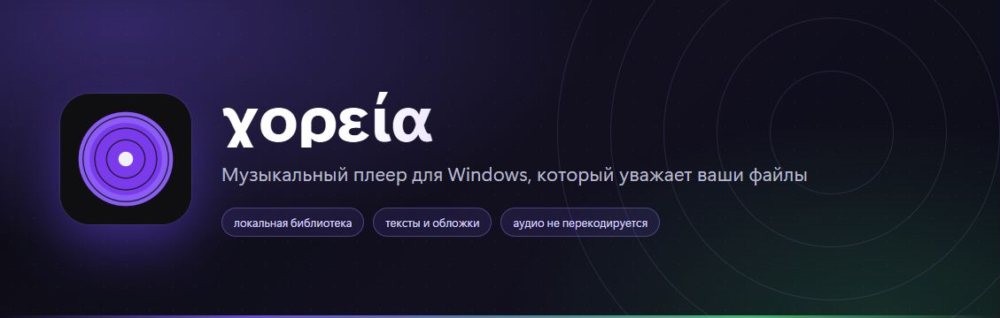
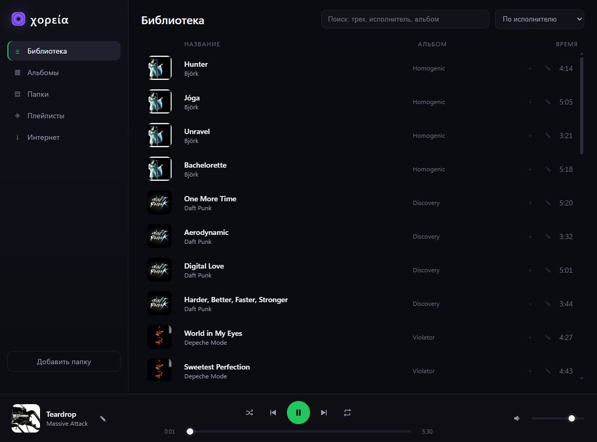
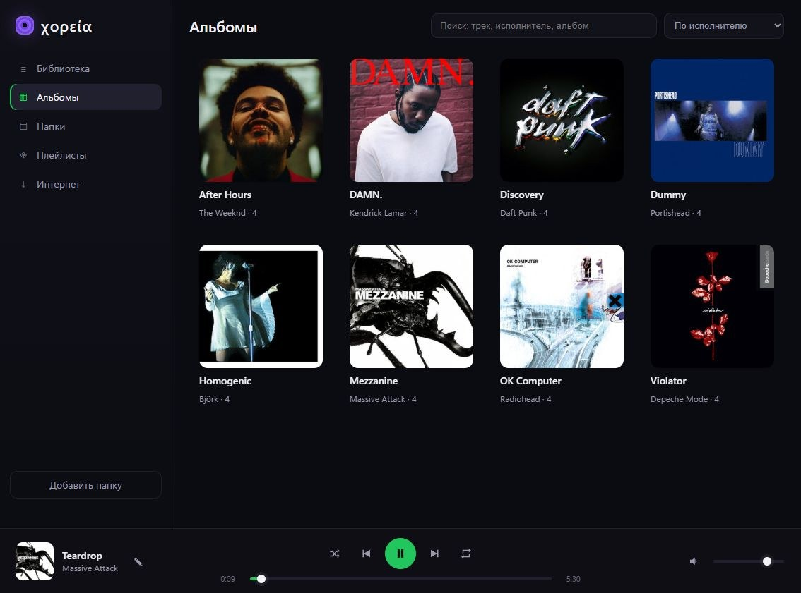
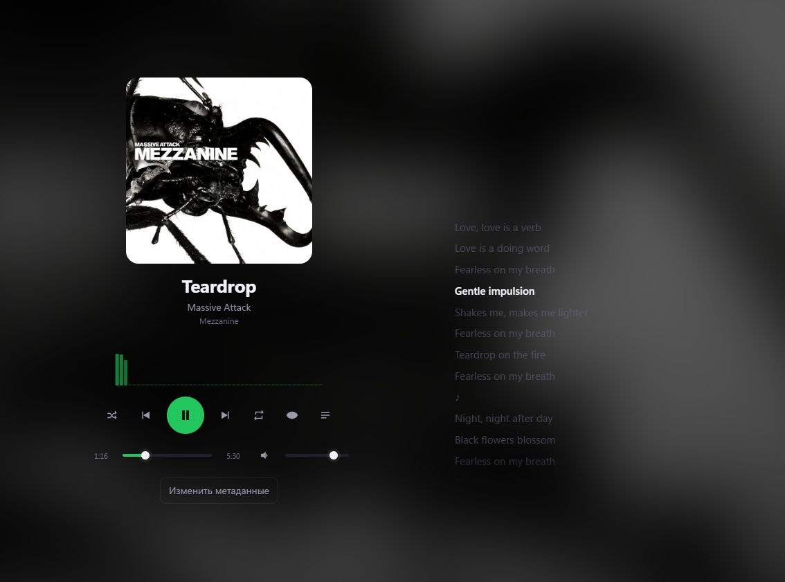
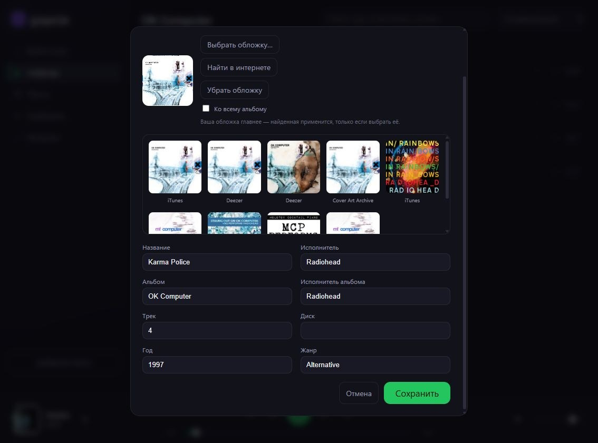
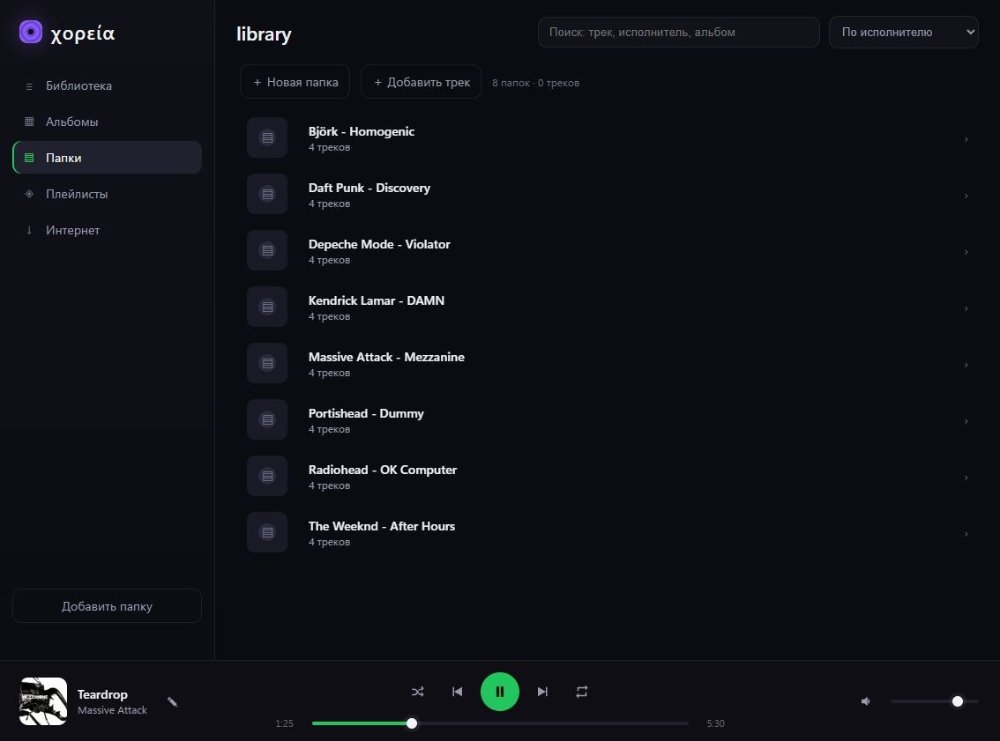
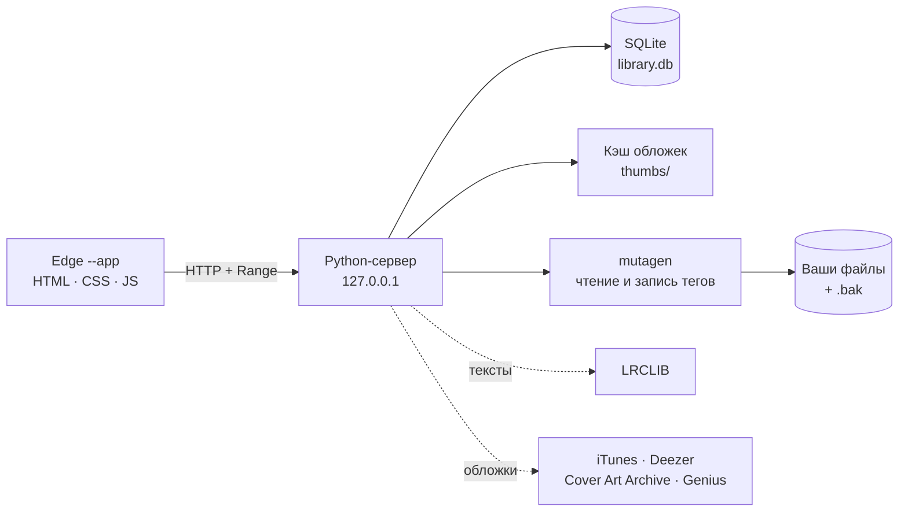

<div align="center">
  

  # χορεία

  **Плеер для Windows, который уважает ваши файлы.**

  Локальная библиотека, синхронизированные тексты, обложки из интернета и редактор метаданных —
  без перекодирования аудио и с резервной копией `.bak` у каждого изменённого файла.

  [](#установка)
  [](#сборка-из-исходников)
  [](#тесты)
  [](pyproject.toml)
  [](LICENSE)
  [](https://github.com/OddS-Programming/CHOREA/stargazers)

  [Возможности](#возможности) · [Скриншоты](#скриншоты) · [Установка](#установка) ·
  [Клавиши](#горячие-клавиши) · [Как устроено](#как-устроено) · [Сборка](#сборка-из-исходников)
</div>

---

χορεία — это не ещё один каталогизатор музыки. Она читает **реальные теги и все вложенные обложки** файла, показывает альбомы так, как они лежат на диске, и умеет аккуратно переписать метаданные, не тронув ни одного байта звука. Всё работает локально: сервер слушает только `127.0.0.1`, интернет нужен лишь для текстов и обложек.

## Возможности

<table>
<tr>
<td width="50%" valign="top">

### 📚 Библиотека
- Инкрементальное сканирование папок `исполнитель/альбом`
- Пустые папки видны, ничего не «исчезает»
- Виртуальный список: 10 000 треков без просадок
- Поиск и 7 сортировок, включая прослушивания
- Автообновление: файл удалили или добавили — список сам перестроится
- Мультивыделение: `Ctrl`, `Shift`, массовое редактирование

### 🎧 Плеер
- Полноэкранный режим с размытым фоном и кроссфейдом между треками
- Живой спектр, громкость, перемотка, повтор
- Shuffle с настоящей историей: «назад» возвращает на тот трек, что играл
- Клик по играющему треку — пауза, а не рестарт
- Системная медиа-карточка Windows обновляется вместе с обложкой

</td>
<td width="50%" valign="top">

### ✍️ Тексты
- Автопоиск синхронизированных текстов в [LRCLIB](https://lrclib.net)
- LRC-подсветка строки, автоскролл по центру
- Клик по строке — переход на таймкод
- Ручной редактор с таймкодами и свободной прокруткой
- Показ текста включается кнопкой-глазом или клавишей `L`

### 🖼 Метаданные и обложки
- Редактирование по одному треку или пачкой
- Пишутся только изменённые поля
- Своя обложка, удаление, «ко всему альбому»
- Поиск обложек в интернете: iTunes, Deezer, Cover Art Archive, Genius
- Ваша обложка всегда главнее: найденная применяется только по клику

</td>
</tr>
</table>

**Файлы и папки.** «Новая папка» создаёт каталог внутри текущего, «Добавить трек» загружает файлы прямо в него, «Удалить» отправляет трек в корзину Windows. У каждой строки трека есть ✕ для удаления, у папки — кнопки Проводника и пересканирования.

**Настройки.** Темы (акцент: зелёный или бургунди; основа: синеватая, чёрная или белая), автопоиск текстов, токен Genius, очистка сохранённых текстов и миниатюр обложек, быстрый доступ к папке данных. Настройки и тексты хранятся в базе.

**Поиск и скачивание.** Раздел «Интернет» ищет треки на hitmos.fm, показывает обложку, исполнителя и длительность, скачивает в выбранную папку библиотеки с прогрессом и вшивает обложку в файл. Папка выбирается нативно через проводник Windows и запоминается. Скачанный трек сразу появляется в библиотеке.

**Обложка альбома без правки файлов.** Выбранная вручную обложка хранится в библиотеке приложения: сетка альбомов показывает её, а теги и файлы остаются нетронутыми.

## Скриншоты

<table>
<tr>
  <td width="50%">
    
    <br><sub><b>Библиотека.</b> Поиск, сортировки, виртуальный список и настоящие обложки.</sub>
  </td>
  <td width="50%">
    
    <br><sub><b>Альбомы.</b> Обложки берутся из тегов файлов, альбомный исполнитель вычисляется сам.</sub>
  </td>
</tr>
<tr>
  <td width="50%">
    
    <br><sub><b>Полноэкранный режим.</b> Фон из обложки, спектр и синхронизированный текст.</sub>
  </td>
  <td width="50%">
    
    <br><sub><b>Метаданные.</b> Правка тегов и поиск обложек в четырёх каталогах.</sub>
  </td>
</tr>
<tr>
  <td width="50%">
    
    <br><sub><b>Папки.</b> Структура как на диске, включая пустые каталоги.</sub>
  </td>
  <td width="50%" valign="middle">
    <h3>Ничего лишнего</h3>
    <p>Папку можно создать, пополнить треками и удалить прямо из приложения.
    Файлы при этом остаются вашими: удаление идёт в корзину, а перед любой записью
    рядом появляется <code>.bak</code>.</p>
  </td>
</tr>
</table>

## Установка

Нужны Windows 10/11 и Microsoft Edge (он есть в системе по умолчанию).

### Готовый exe

1. Соберите приложение по инструкции [ниже](#сборка-из-исходников).
2. Установите ярлыки:

```powershell
powershell -ExecutionPolicy Bypass -File tools\install-player.ps1
```

Скрипт копирует onedir-сборку в `%LOCALAPPDATA%\Programs\Choreia` и создаёт ярлыки на рабочем столе и в меню «Пуск». Запуск — `Choreia.exe`, поиск в `Win+S` по слову «χορεία».

### Из исходников

```powershell
git clone https://github.com/OddS-Programming/CHOREA.git
cd CHOREA
python -m venv .venv
.venv\Scripts\python.exe -m pip install -e .
.venv\Scripts\python.exe tools\run_app.py
```

### Первый запуск

1. Раздел «Папки» → «Добавить папку» → укажите корень музыки (например, `C:\Users\you\Music`).
2. Дождитесь сканирования: прогресс виден внизу сайдбара.
3. Играть — двойной клик по треку или пробел.

## Горячие клавиши

| Клавиша | Действие |
| --- | --- |
| `Space` | Играть / пауза |
| `←` `→` | Перемотка на 5 секунд |
| `N` / `P` | Следующий / предыдущий трек |
| `M` | Выключить звук |
| `L` | Показать или скрыть текст |
| `/` | Перейти к поиску |
| `Esc` | Закрыть окно, диалог или полноэкранный режим |

## Как хранятся данные

| Что | Где |
| --- | --- |
| Библиотека, плейлисты, тексты | `%LOCALAPPDATA%\Choreia\library.db` |
| Кэш обложек | `%LOCALAPPDATA%\Choreia\thumbs\` |
| Токен Genius (необязательно) | `%LOCALAPPDATA%\Choreia\credentials.json` |
| Отчёт о падении | `%LOCALAPPDATA%\Choreia\crash.txt` |

Приложение никогда не перекодирует звук: при сохранении аудиоданные копируются байт в байт, переписываются только теги и обложки. Запись идёт через временную копию, поэтому сбой не испортит оригинал. Если файл в этот момент играет, используется `ReplaceFileW` — воспроизведение не прерывается.

## Как устроено



- **UI** — обычные HTML/CSS/JS без фреймворков, открытые в отдельном окне Edge `--app` (без адресной строки).
- **Сервер** — `ThreadingHTTPServer` с Range-запросами для перемотки, кэшем миниатюр и JSON API.
- **Индекс** — SQLite: треки, папки, плейлисты, настройки, тексты. Сканер обновляет только изменившиеся файлы.
- **Файлы** — mutagen и собственные писатели для MP3/FLAC/M4A/OGG/Opus; WAV читается, но не переписывается.
- **Одно окно** — именованный мьютекс `Local\ChoreiaPlayer`: повторный запуск фокусирует уже открытое приложение.

## Тесты

```powershell
.venv\Scripts\python.exe -m pytest -q
```

```text
108 passed
```

Покрыты сканер, все форматы тегов, Range-запросы, редактор метаданных, удаление в корзину, поиск текстов и обложек, устойчивость к занятому файлу.

## Сборка из исходников

```powershell
.venv\Scripts\python.exe -m pip install pytest pyinstaller
.venv\Scripts\pyinstaller.exe --noconfirm --onedir --windowed --name Choreia ^
  --icon assets/app.ico ^
  --add-data "src/choreia/web;choreia/web" ^
  --collect-all webview ^
  --hidden-import clr ^
  --hidden-import choreia.sources.covers ^
  tools/run_app.py
powershell -ExecutionPolicy Bypass -File tools\install-player.ps1
```

Сборка onedir, а не onefile: приложение стартует примерно за 1,5 секунды.

## CLI

В репозитории остался и консольный инструмент для разбора «грязных» файлов:

```bash
python -m choreia inspect "track.mp3"
python -m choreia clean "track.mp3" --keep 2 --title "Название" --artist "Исполнитель"
```

`inspect` покажет все версии тегов и каждую вложенную обложку, `clean` оставит один набор тегов и одну обложку, сделав `.bak`.

## Дорожная карта

- [x] Библиотека, папки, альбомы, плейлисты
- [x] Полноэкранный режим, спектр, кроссфейд фона
- [x] Тексты: LRCLIB, резервный lyrics.ovh и ручной редактор LRC или обычного текста
- [x] Обложки из интернета, ручная обложка альбома внутри приложения и массовое редактирование
- [x] Удаление в корзину, автообновление папок
- [x] Сохранение тегов без остановки воспроизведения
- [x] Окно настроек с темами: зелёный/бургунди и синеватая/чёрная/белая основа
- [x] Поиск и скачивание треков из интернета
- [ ] Обновления в один клик

## Благодарности

- [LRCLIB](https://lrclib.net) — синхронизированные тексты без ключей и регистрации
- [lyrics.ovh](https://lyrics.ovh) — резервный источник обычных текстов
- [hitmos.fm](https://hitmos.fm) — поиск и скачивание треков
- [iTunes Search API](https://performance-partners.apple.com/search-api), [Deezer API](https://developers.deezer.com), [Cover Art Archive](https://coverartarchive.org), [MusicBrainz](https://musicbrainz.org) — обложки
- [Genius API](https://docs.genius.com) — дополнительный источник обложек
- [mutagen](https://mutagen.readthedocs.io) и [Pillow](https://python-pillow.org) — теги и изображения

## Лицензия

[MIT](LICENSE) © 2026 OddS-Programming
